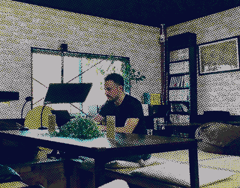

  

Cuando era pequeño, cualquier juguete mecánico que llamase mi atención acababa desmontado y despedazado. Intentaba averiguar cómo funcionaba y, en caso de éxito, poder aplicárselo a otros juguetes. Sobra decir que la mayoría de estos experimentos no llegaban a nada y me comí muchas broncas por parte de mi familia debido a aquel comportamiento.

Otra cosa que marcó mi personalidad futura fue crecer en una familia con poco dinero. No pasábamos necesidades, pero tampoco podíamos permitirnos ciertos lujos, como los videojuegos. Los videojuegos me fascinaban y se desarrolló en mí la idea de que tal vez, si aprendía cómo hacerlos, podría crear los míos propios.

Estoy agradecido de haber nacido en la era de los ordenadores y los videojuegos. En ellos puedo encontrar un sitio donde experimentar y dar rienda suelta a mi curiosidad, tanto como jugador como creador.
